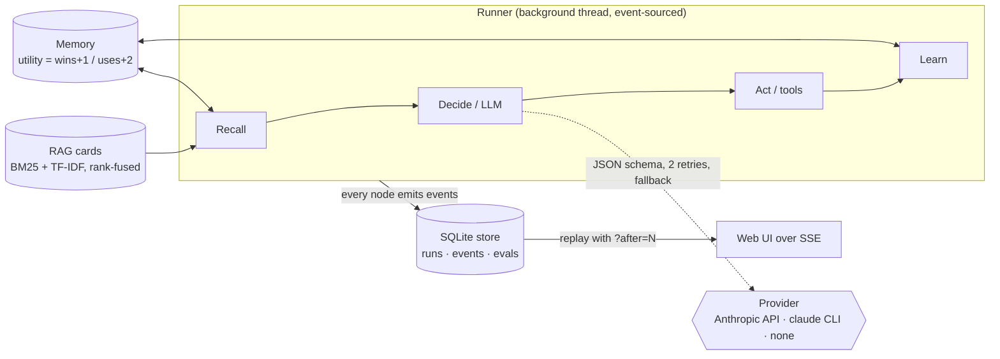

<div align="center">

# agentkit

**A small agent runtime, written from scratch.**<br>
Bounded state graphs · event-sourced runs · memory that learns what helps · hybrid RAG


[Why](#why) · [Architecture](#architecture) · [Try it in 30 seconds](#try-it-in-30-seconds) · [Modules](#modules) · [Built with it](#built-with-it)

</div>

---

## Why

Most agent frameworks hide the loop. agentkit keeps it in plain sight: about 750 lines you can read in an
afternoon, with the three things production agents actually need:

- **A loop that cannot run away.** Every graph has a hard step budget, so a routing bug ends a run instead of spinning.
- **Runs you can replay.** Every node writes durable events; a reloaded page replays the whole trace over SSE.
- **Memory that improves.** Lessons are ranked by relevance multiplied by a *learned* utility: the share of past recalls that preceded a good outcome. Helpful lessons rise, misleading ones sink.

And one rule underneath all of it: **the model proposes, code disposes.** Model output is validated against a
JSON schema, retried twice, then replaced by a deterministic fallback, so a call site never raises and never
trusts free text.

## Architecture



## Try it in 30 seconds

No API key needed. With no provider configured, every LLM call uses its deterministic fallback.

```bash
pip install -e .
python examples/hello.py
```

```text
node_start recall
node_end   recall  recalled 1 lesson(s)
node_start decide
node_end   decide
node_start learn
node_end   learn
stance: flat | lesson utility now: 0.667
```

The lesson that was recalled before a good outcome went from a neutral `0.5` to `0.667`. That feedback
loop is the whole self-improvement mechanism. See [`examples/hello.py`](examples/hello.py).

## Modules

| Module | What it does |
|---|---|
| `graph.py` | Bounded `StateGraph`: nodes, conditional routes, a hard step limit, a trace per node |
| `runner.py` | Event-sourced runs in background threads, replayable over SSE, plus `run_suite` for evals |
| `memory.py` | Long-term lessons ranked by relevance × Laplace-smoothed utility, near-duplicate suppression |
| `rag.py` | Hybrid BM25 + TF-IDF retrieval with reciprocal-rank fusion over markdown cards |
| `llm.py` | JSON-schema outputs, 2 retries, deterministic fallback per call. Provider: Anthropic API → headless `claude -p` with every tool disabled → none |
| `store.py` | SQLite store for runs, events, memories, evals and key-value state |
| `serve.py` | FastAPI scaffolding: run endpoints, SSE, static UI |
| `http.py` | `fetch_json` with a certifi-backed SSL context (fixes macOS certificate errors) |
| `web/` | Shared `kit.js` and `kit.css` used by the three front ends |

## Built with it

| Project | Domain | What it shows |
|---|---|---|
| [**holdout**](https://github.com/cacheycat/holdout) | Trading | A strategy-research agent that cannot see the answer: blind data, sealed holdout, random-search control |
| [**casefile**](https://github.com/cacheycat/casefile) | Web3 | An on-chain investigator on a fetch budget that cites its evidence |
| [**undertow**](https://github.com/cacheycat/undertow) | Web3 × Trading | A positioning desk over live Hyperliquid whale data that scores its own calls |

## Install

```bash
pip install "agentkit @ git+https://github.com/cacheycat/agentkit.git"   # needs repo access
pip install -e ".[dev]"                                                   # local development
pytest -q && ruff check .
```

Optional: `pip install -e ".[anthropic]"` to use the Anthropic SDK instead of the `claude` CLI.

## License

MIT
